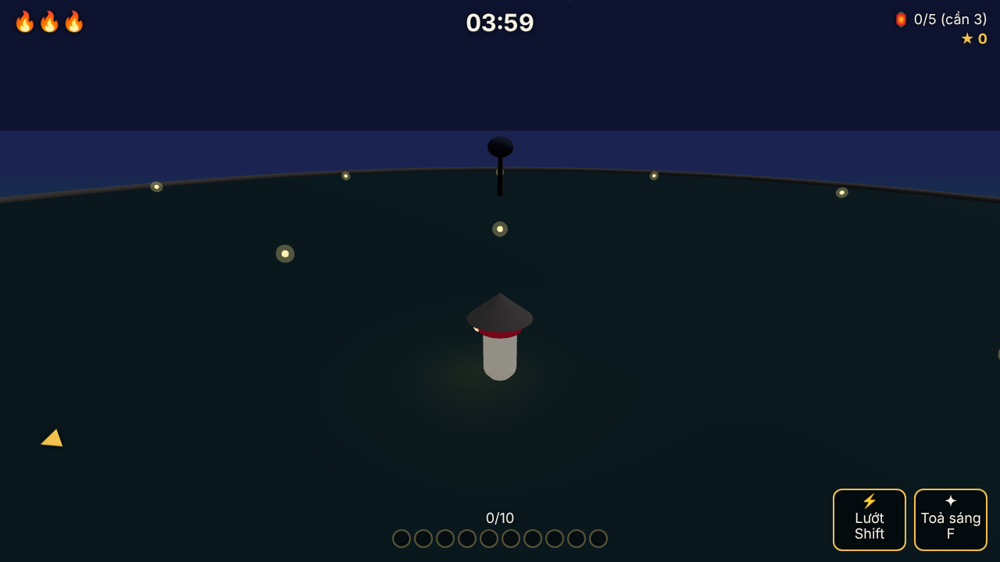

# Đảo Đèn Lồng v1.0.0

> Video demo: không có (xem bằng chứng ở docs/proof/phase-4/, bench.json, soak.json).



Game 3D góc nhìn thứ ba. Bạn là **Mây** (nón lá + đèn nhỏ): nhặt đom đóm, thắp lại các **Đèn Lồng Lớn** trên ba hòn đảo, giữ chúng sáng tới bình minh và tránh **Bóng Mực**.

## Cài và chạy (tối đa 3 lệnh)
```
git clone https://github.com/ducminhnwork/K5-L3A-DAY12-NguyenDucMinh-2A202603563-AI-SDLC-Dao-Den-Long && cd K5-L3A-DAY12-NguyenDucMinh-2A202603563-AI-SDLC-Dao-Den-Long
npm install
npm start        # tự build lần đầu, rồi mở http://localhost:5173
```
Hoặc tải **bản Release** (`dao-den-long-v1.0.0.zip`), giải nén, chạy `node scripts/run.js` (chỉ cần Node, không cần `npm install`). Hoặc Docker: `docker build -t ddl . && docker run -p 5173:5173 ddl`.

**Yêu cầu:** Node.js 18+ (khuyên 20+), trình duyệt hiện đại có WebGL (Chrome/Edge/Firefox). Benchmark cần Chrome hoặc Edge. Windows/macOS/Linux.

## Điều khiển (đổi được trong Cài đặt → Phím điều khiển)
| Phím mặc định | Việc |
|---|---|
| W A S D | đi (theo hướng camera) |
| Chuột (nhấp vào màn hình) / ← → | xoay camera |
| Space | nhảy |
| Shift | lướt |
| E | nạp đom đóm / châm dầu cho đèn gần nhất (trong 2 m) |
| F | toả sáng: tốn 3 đom đóm, choáng và đẩy Bóng Mực trong 5 m |
| Esc / P | tạm dừng |

Cài đặt còn có: âm lượng, độ nhạy chuột, bảng màu mù màu, **giảm chuyển động** (tắt rung camera, loé màn hình, nhấp nháy đồng hồ), **chữ lớn ×1.25**, **Khôi phục mặc định** cho phím. Đổi phím trùng phím đang dùng sẽ bị từ chối kèm cảnh báo. Mọi cài đặt được lưu.

Phụ đề/chỉ báo hình ảnh: "Bóng Mực xuất hiện!" kèm mũi tên đỏ ở rìa màn hình chỉ hướng, "Gió sắp nổi!", "10 giây cuối!", và "Đèn Lx sắp cạn dầu" khi dầu < 30. Cỡ chữ giao diện ≥ 18 px ở 1280×720.

## Luật và điểm
- Ba Đêm: **Đảo Bến** (5 đèn, 240 s), **Đảo Cau** (hai đảo nối cầu tre, bục nhảy, Gió Lạc, Bùa Gió, 6 đèn, 270 s), **Đảo Chuông** (3 tầng, dốc, gió mạnh, 7 đèn, 300 s).
- Thắng một Đêm nếu còn sống khi hết giờ và số đèn đang sáng ≥ 60% (3/5, 4/6, 5/7). Thắng đủ ba Đêm để thấy Bình Minh.
- Đom đóm tự nhặt khi lại gần. Sức chứa 10, +2 sau mỗi lần thắp, tối đa 20. Đèn cần 10 đom đóm để thắp lần đầu, 5 để thắp lại.
- Đèn sáng có dầu (100, hao 1/s); E ở đèn đang sáng để châm dầu. Còn ≥ 30 dầu: vùng an toàn 6 m; dưới 30: mất vùng, nhấp nháy, Bóng Mực tới hút dầu.
- Bị Bóng Mực chạm: −1 ngọn lửa. Hết lửa thì thua.
- Điểm: nạp/châm +5/đom đóm; thắp lần đầu +100; thắp lại +40; toả sáng trúng +5/bóng (+15 nếu bóng đang hút dầu); bình minh +50 + dầu còn lại cho mỗi đèn sáng và +50/ngọn lửa còn lại.

## Bảng xếp hạng
Sau màn Bình Minh (thắng Đêm 3) hoặc khi thua ở bất kỳ Đêm nào, game hỏi tên (3–12 ký tự: chữ, số, `_`; có dấu tiếng Việt cũng được). Mỗi mục có `name`, `score` (tổng điểm các Đêm đã thắng), `nights_won`, `achieved_at` (ISO 8601 có múi giờ), `seed`. Giữ top 10, điểm cao trước, bằng điểm thì ai đạt trước đứng trên. Lưu bền ở `data/leaderboard.json` (đổi bằng biến `LEADERBOARD_FILE`). Menu chính có màn Bảng xếp hạng.
```
node scripts/run.js --export-leaderboard out.json     # -> {"entries":[...]}
```

## Test, headless, bench, soak
```
npm test                                   # 96 test (node:test)
npm run proof                              # scenario thật + tất định + hiệu năng + soak; ghi docs/proof/phase-4/
node src/headless.js --seed 1 --night 1 --ticks 600 --out out.jsonl [--scenario f.json] [--inputs f.json] [--snapshot-every 10]
node scripts/bench.js --seed 42 --duration 30 --out bench.json     # (npm run bench)
node scripts/soak.js  --seed 7  --nights 10   --out soak.json      # (npm run soak)
```
- **Headless** theo Test Contract (`game.contract.json`, v1.3). Lỗi định dạng → exit 2.
- **Bench:** mở Chrome/Edge ở cửa sổ 1280×720 (không toàn màn hình, `pixelRatio` 1), Đêm 1 đủ hiệu ứng và ánh sáng, 200 Bóng Mực `wander`, 100 đom đóm, đèn L1–L3 đầy dầu, camera quay quanh (0,0,0) bán kính 30 m, cao 15 m, 15 s/vòng, khởi động 3 s rồi đo `--duration` s. **Vsync** tắt bằng cờ Chrome `--disable-gpu-vsync --disable-frame-rate-limit` (trình duyệt không cho tắt vsync theo cách khác; `vsync_off` chỉ xác nhận cờ đã truyền). Đặt `CHROME_PATH` nếu không tự tìm thấy trình duyệt. Chạy trên máy có GPU thật, rút điện hoặc cắm sạc, đóng ứng dụng nặng khác.
- **Soak:** 10 Đêm liên tiếp (1→2→3 xoay vòng) headless trong một tiến trình, đầu vào ngẫu nhiên theo seed, đo RSS đầu/cuối. Đạt khi `crashes = 0` và `mem_end_mb ≤ 1.2 × mem_start_mb`.
- Kết quả `bench.json` và `soak.json` đã chạy trên máy thật nằm ở thư mục gốc repo.
- Số liệu chuẩn ở `src/sim/config.js`; giả định ở `docs/notes/`; spec ở `docs/spec-phase-*.md`; ADR ở `docs/adr/`; bằng chứng ở `docs/proof/`; retro ở `docs/RETRO.md`.

## Sáng tạo của tôi
Chỉ ở bản web, **tắt trong bench/soak và không ảnh hưởng headless**: bầu trời sao, đom đóm lơ lửng nhấp nhô, đèn lồng đung đưa và nhấp nháy khi sắp cạn dầu, nhân vật nhấp nháy khi bất tử, lá bay báo gió, rung camera và loé đỏ khi bị trúng (tắt được bằng "Giảm chuyển động"), nhạc nền và âm thanh tổng hợp bằng WebAudio (không dùng file ngoài), chế độ mù màu, và toàn bộ mô hình 3D dựng bằng hình khối thủ tục (không asset ngoài).

## Cấu trúc
`src/sim/` lõi mô phỏng (không phụ thuộc đồ hoạ) · `src/headless.js` CLI · `src/web/` Three.js · `src/leaderboard*.js` bảng xếp hạng · `scripts/` run, server, bench, soak, proof, release · `tests/` · `docs/` · `AGENTS.md`, `.claude/`, `.github/` harness.

Giấy phép: MIT (`LICENSE`). Nguồn và công cụ AI: `CREDITS.md`.
